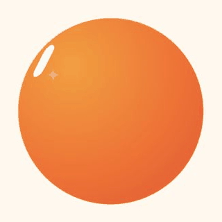

# 星橙Q

量子星橙的 SVG 动画形象。保留 Bloub 的 14 状态变形、眼睛动画、视线跟随、
时间轴和多格式导出能力，并将默认角色改造成橙色圆球形象“星橙Q”。

本项目基于 [jeremy-prt/bloub](https://github.com/jeremy-prt/bloub) 改造。
上游代码采用 MIT 许可；原项目说明其模仿的角色设计不包含在 MIT 许可内，
因此本版本使用独立的量子星橙品牌配色与表面识别元素。

在线体验：[星橙Q 动画形象](https://xiandan-superman.github.io/xingcheng-q/)

角色状态审阅：[14 个产品状态与 8 个基础情绪](https://xiandan-superman.github.io/xingcheng-q/#roles)

## 品牌角色资产

- [星橙Q 角色资产包 V2.0 使用说明](小程序/量子星橙-开工包/04-设计/星橙Q-角色资产包-V2/README.md)
- [下载 V2.0 正式压缩包](小程序/量子星橙-开工包/04-设计/星橙Q-角色资产包-V2.0-正式版.zip)
- [小程序调用映射](小程序/量子星橙-开工包/04-设计/星橙Q-角色资产包-V2/docs/04-小程序调用映射.md)

V2.0 包含 14 个产品语义动画、8 个基础情绪、静态兜底图、3 个克制的场景配件动作、表情包、分享卡、海报以及品牌使用规范。全部角色画面均来自本项目的 Bloub SVG 引擎。



## Running it

```bash
pnpm install
pnpm dev
```

Then open http://localhost:5190.

```bash
pnpm test     # vitest
pnpm build    # vue-tsc --noEmit && vite build
```

Vue 3, Vite, TypeScript, Tailwind 4. No ESLint and no Prettier: `vue-tsc` is the
only gate, so run `pnpm build` before you call something done.

## What's in it

The rail on the left switches between three views. **Customise** offers 8 body
shapes, 12 colours and 16 rest expressions, kept between visits. **Animations** is
a small editor: arrange states into a timeline, set how long each is held, save the
result. **Settings** holds the language (French, English or Chinese) and the
credits.

Anything on screen can be exported: the avatar as SVG, PNG or an animated GIF, and
a whole timeline as GIF or MP4. The still formats need no library at all, and the
video encoder is only fetched the first time you ask for one.

Two URLs are worth knowing:

- `#planche`: the 14 states side by side, frozen. Quick visual check.
- `#etat=orbit&stop`: opens one state directly, playback paused.


## Why the numbers look arbitrary

They're measured, not chosen. The reference video was cut at 10 fps and each
state measured off the frames: silhouettes by sub-pixel ray casting, eyes by
capsule fitting, colours and stroke widths by direct sampling.

So the constants in the code are **measurements**, and rounding them to friendlier
values breaks the resemblance, which is the only thing this project is trying to
get right. A few are counter-intuitive enough to be worth knowing before you
correct anything:

| What you'd assume | What the video shows |
|---|---|
| The eyes lean `//` | They lean `\\`, around 26° off vertical |
| The body is a squircle | It's a perfect circle, radial deviation under 0.7% |
| Transitions are springs | Exponential ease-outs; the body never overshoots |
| The comet crosses the screen | The dot stays put, the trail orbits it |
| The avatar floats at rest | It doesn't. The life is gaze drift and blinking |

[docs/measurements.md](docs/measurements.md) has the rest, including how to
regenerate the extracted profiles.

## How it's put together

`src/bot/` is framework-free and clock-free: `engine.sample(t)` is a pure
function of time. Pausing, resuming, jumping to an arbitrary date and running
tests all produce the same image, which is what makes the frozen state board and
the DOM-less test suite possible.

| | |
|---|---|
| [docs/architecture.md](docs/architecture.md) | The engine, radial-profile morphing, eyes as mask holes |
| [docs/measurements.md](docs/measurements.md) | What was measured, and regenerating `profiles.ts` |
| [docs/intro.md](docs/intro.md) | The arrival sequence, and why it only plays one state |
| [docs/interface.md](docs/interface.md) | Layout, the three-column scene, CSS traps |
| [docs/export.md](docs/export.md) | Exporting to SVG, PNG, GIF and MP4 |
| [docs/i18n.md](docs/i18n.md) | The hand-rolled translation layer |

## Using the component

```vue
<BloubBot v-model:block="block" v-model:state="state" v-model:playing="playing" />
<BloubBot state="orbit" :size="120" :frozen-at="1.2" />
```

`block` is the playback cursor: a montage can play the same state twice, so the
index is what identifies where you are; `state` follows it as an output. Pass
`frozenAt` and the component renders one exact frame with no animation loop, which
is how the thumbnails and the state board are drawn.

Props: `size`, `shape`, `color`, `expression`, `paper`, `frozenAt`, `cycle`,
`follow`, `gaze`. Models: `block`, `state`, `playing`, `elapsed`. See
[BloubBot.vue](src/components/BloubBot.vue) for the details.

## Changes

[CHANGELOG.md](CHANGELOG.md), one entry per release — which is how you tell whether the
copy you have carries a given fix.

## License

MIT. See [LICENSE](LICENSE).

Not affiliated with, endorsed by or connected to x.ai. It recreates the visual
behaviour of their bot avatar as an exercise; "Grok" and "x.ai" belong to their
owners. The MIT licence covers the code in this repository, not the design it
imitates.
